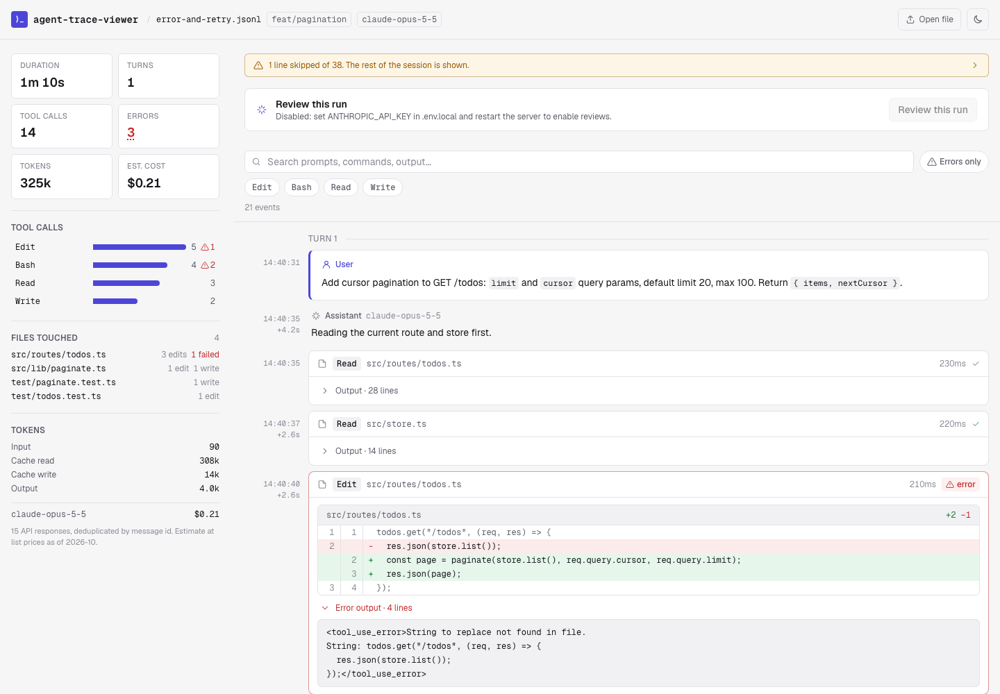
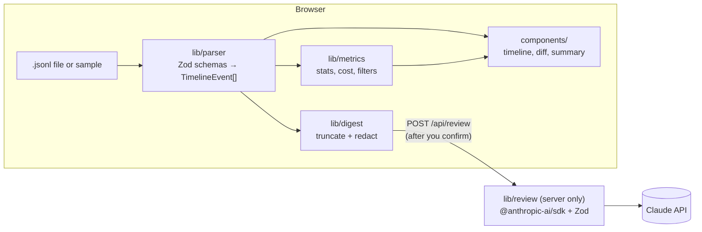

# agent-trace-viewer

Inspect Claude Code session transcripts as a timeline of prompts, tool calls, results and diffs, and optionally get a structured review of the run.



<sub>Dark mode: [docs/screenshot-dark.png](docs/screenshot-dark.png). Both screenshots use the bundled synthetic sample `error-and-retry`.</sub>

## Why

Claude Code writes every session to `~/.claude/projects/<project>/<session>.jsonl`. Reading those files raw is slow: one line per content block, tool results detached from their calls, usage repeated across lines. When reviewing an agent run you want to answer a few questions quickly: what was asked, what the agent ran, what failed, what it changed, and whether its final claims are backed by tool output. This tool is built for that.

## Features

- **Load a transcript** by drag-and-drop or file picker, or open one of three bundled samples. Parsing runs in the browser.
- **Timeline** grouped by turn: user prompts, assistant text, thinking (when present), tool calls with their input and collapsible output. Failed tool results are highlighted and open by default. Each step shows its UTC time and the gap since the previous step.
- **Edit diffs**: `Edit` and `MultiEdit` calls render as a line diff of `old_string` → `new_string`.
- **Summary**: duration, turns, tool calls by tool (bar chart, click to filter), errors, files touched (from `Edit`/`Write` inputs), token usage and estimated cost when `usage` fields are present. Usage is deduplicated by message id.
- **Filters**: by tool name, errors only, and free-text search across prompts, commands and output.
- **Tolerant parsing**: Zod schemas accept unknown fields, line types and block types. Malformed lines are skipped and listed with their line numbers instead of failing the whole file.
- **Review this run** (optional): sends a redacted, truncated digest to the Claude API and shows a structured review: whether the task was completed, unverified claims, skipped steps and risky actions, each linked back to the timeline step. You see the exact payload before it is sent. Without an API key the button is disabled and everything else works.

## Quickstart

Requires Node.js 20.9 or later.

```bash
git clone https://github.com/felipesergiob/agent-trace-viewer.git && cd agent-trace-viewer
npm install
npm run dev                          # http://localhost:3000
cp .env.example .env.local           # optional: set ANTHROPIC_API_KEY to enable reviews
```

Open `http://localhost:3000/?sample=unverified-success` to go straight to a sample.

### Configuration

| Variable | Default | Purpose |
| --- | --- | --- |
| `ANTHROPIC_API_KEY` | unset | Enables the review endpoint. |
| `ANTHROPIC_MODEL` | `claude-sonnet-5-5` | Model used for reviews. |
| `ANTHROPIC_EFFORT` | unset | Optional effort level (`low` … `max`). |
| `ANTHROPIC_FALLBACKS` | on | Sends `fallbacks: "default"` so a refused request is retried server-side. Set to `off` for models that don't support it. |

## Architecture



| Module | Responsibility |
| --- | --- |
| `lib/parser` | Pure. Turns JSONL text into a typed `ParsedSession`: events, per-message usage, parse stats. Pairs `tool_result` blocks with their `tool_use` and computes call durations. Never throws. |
| `lib/metrics` | Pure. Session metrics, price table and cost estimate, timeline filters. |
| `lib/diff` | Pure. LCS line diff for Edit calls. |
| `lib/digest` | Pure. Builds the numbered, truncated text digest for review and applies pattern-based redaction. Runs in the browser so the payload can be previewed. |
| `lib/review` | Server only (`server-only`). Config from env, prompt, the Anthropic SDK call using structured outputs (`messages.parse` with a Zod schema), and error mapping. The response is validated with Zod again on the server and on the client. |
| `app/api/review` | `GET` reports whether reviews are configured; `POST` runs a review. |
| `components/` | Client UI. No component reads the raw JSONL shape. |
| `scripts/generate-samples.mjs` | Generates the synthetic sample sessions in `public/samples/`. |

The transcript format is undocumented and changes between Claude Code versions. The parser declares only the fields it reads and treats everything else as optional, so new fields and line types degrade to "ignored" rather than errors.

## Privacy

- Transcripts are read with the File API and parsed in the browser. They are not uploaded, stored, or sent anywhere by the viewer.
- The review feature sends one request, only after you click **Send to Claude**. The request body is the digest shown in the preview:
  - user prompts, assistant messages, and each tool call with its input and output, truncated per step (for example 600 characters of tool output, 1,200 for errors), with the middle of very long sessions omitted to stay under 120,000 characters;
  - the project directory name, branch, models, and tool and file counts.
  - Not included: thinking blocks, injected context (system reminders, slash command output), images, and full file contents.
- Before sending, the digest is redacted for common secret formats (API keys, tokens, JWTs, private keys, credentials in URLs, `*_SECRET=`-style assignments), email addresses, and home directory paths. The server applies the same redaction again before calling the API. Redaction is pattern-based and best-effort; check the preview for anything sensitive.
- The server does not log or store digests. Data sent to the Claude API is handled under Anthropic's API terms.

## Tests

```bash
npm run test        # Vitest: parser, metrics, filters, diff, digest/redaction, review schema, UI
npm run lint
npm run typecheck
npm run build
```

- Parser tests cover well-formed sessions, usage deduplication across multi-line messages, meta prompts, orphan tool results, CRLF, unknown fields and types, and malformed input (invalid JSON, wrong types, truncated lines, arbitrary bytes).
- Component tests (React Testing Library, jsdom) load a sample, apply filters, open a file through the picker, check the disabled review state, and run the review flow against a mocked endpoint.
- CI (`.github/workflows/ci.yml`) runs install, lint, typecheck, test and build on Node 24.

## Sample sessions

The three sessions in `public/samples/` are synthetic, written for this repo against a fictional `tasklane-api` project. They follow the real line format. Regenerate them with `npm run samples`.

| Sample | What it shows |
| --- | --- |
| `fix-failing-test` | Reproduces a failing test, fixes the handler, runs the file, the suite and `tsc`. |
| `error-and-retry` | An `Edit` that fails on a whitespace mismatch, a type error, a broken test, each recovered. Contains one truncated line. |
| `unverified-success` | Says "all tests pass" without running any, deletes the lockfile, and edits `.env`. |

## What I'd do next

- Parse in a Web Worker and virtualize the timeline for sessions with tens of thousands of lines.
- Follow subagent transcripts: link `Agent`/`Task` calls to their sidechain sessions.
- Compare two runs of the same task side by side (tool usage, cost, outcome).
- Export a review and selected steps as Markdown for a PR comment or a review report.
- A Playwright smoke test against `npm start`, and a fixture corpus from several Claude Code versions to catch format drift.

## License

MIT. See [LICENSE](LICENSE).
